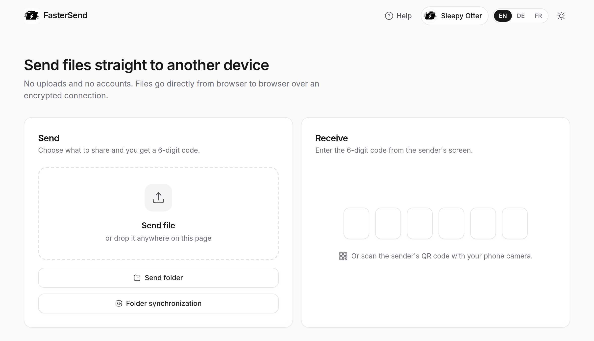
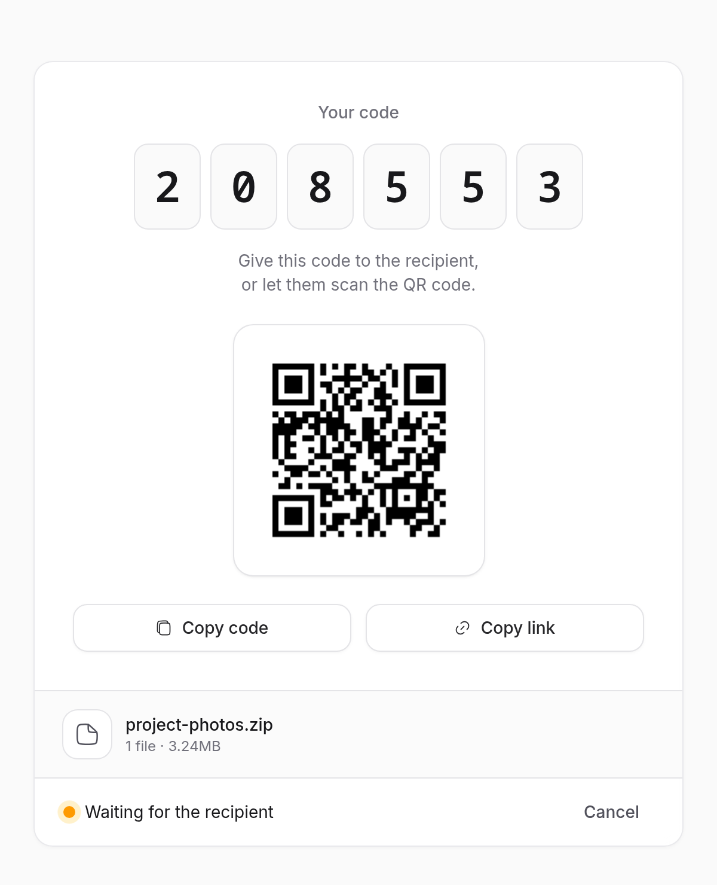
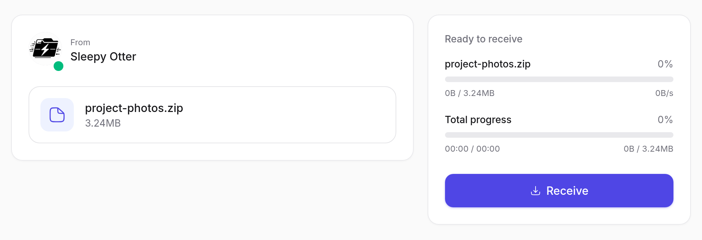

# FasterSend

[](https://github.com/thereisnotime/FasterSend/actions/workflows/ci.yml)
[](LICENSE)

Send files and folders straight from one browser to another. Pick a file, share the 6-digit code or QR code, and the data goes peer to peer over WebRTC. The server only introduces the two browsers to each other; file contents never pass through it and nothing is stored.

FasterSend is a self-hostable hard fork of [FastSend](https://github.com/ShouChenICU/FastSend) by ShouChenICU.

<picture>
  <source media="(prefers-color-scheme: dark)" srcset="docs/screenshots/home-dark.png">
  
</picture>

<table>
  <tr>
    <td width="38%">
      <picture>
        <source media="(prefers-color-scheme: dark)" srcset="docs/screenshots/sender-dark.png">
        
      </picture>
    </td>
    <td width="62%">
      <picture>
        <source media="(prefers-color-scheme: dark)" srcset="docs/screenshots/recipient-dark.png">
        
      </picture>
    </td>
  </tr>
</table>

## Features

- Send a single file or a whole folder
- Folder sync: compare against a local folder and choose which added, changed and deleted files to transfer
- The sender approves each recipient before anything is sent (or turns on auto-approve)
- Stays on the local network when both devices are on it
- No accounts, no uploads, no tracking, no external requests (fonts and icons are bundled)
- English, German and French UI, light and dark theme
- Installable as a PWA
- One small container image for amd64 and arm64, running as a non-root user

## How it works

1. The sender opens a WebSocket to the FasterSend server and gets a 6-digit code.
2. The recipient enters the code (or scans the QR code), and the server relays the WebRTC offer, answer and ICE candidates between the two browsers.
3. The browsers open an encrypted (DTLS) data channel directly to each other and the files go over it.
4. If a direct connection is impossible, for example both sides are behind strict NAT, traffic goes through a TURN relay if you configure one. The relay only sees encrypted data.

## Browser support

| | Chromium desktop (Chrome, Edge) over HTTPS | Firefox, Safari, mobile, or plain HTTP |
| --- | --- | --- |
| Send and receive files | Yes, streamed to disk | Yes, buffered in memory, so very large files (over about 1 GB) may fail |
| Send folders, folder sync | Yes | No |

Folder features need the [File System Access API](https://developer.mozilla.org/en-US/docs/Web/API/File_System_API), which browsers only expose on secure origins. Serve FasterSend over HTTPS (or `localhost`) to get them.

## Running it

The image is `ghcr.io/thereisnotime/fastersend`. It listens on port 3000.

| Tag | Source |
| --- | --- |
| `main` | Latest commit on `main` |
| `X.Y.Z`, `X.Y`, `latest` | Release tags (`v*`) |
| `sha-<short>` | A specific commit |

### Docker

```bash
docker run -d --name fastersend --restart unless-stopped -p 3000:3000 \
  -e NUXT_PUBLIC_SITE_URL=https://send.example.com \
  ghcr.io/thereisnotime/fastersend:main
```

Or with Compose from a checkout of this repository:

```bash
docker compose up -d
```

### Podman

The image runs rootless as-is:

```bash
podman run -d --name fastersend -p 3000:3000 \
  -e NUXT_PUBLIC_SITE_URL=https://send.example.com \
  ghcr.io/thereisnotime/fastersend:main
```

`podman compose up -d` works with the same `docker-compose.yaml`, given a compose provider (`podman-compose` or `docker-compose`) is installed.

To run it as a systemd service with [Quadlet](https://docs.podman.io/en/latest/markdown/podman-systemd.unit.5.html) (Podman 4.4+), save this as `~/.config/containers/systemd/fastersend.container`:

```ini
[Unit]
Description=FasterSend

[Container]
Image=ghcr.io/thereisnotime/fastersend:main
ContainerName=fastersend
PublishPort=3000:3000
Environment=NUXT_PUBLIC_SITE_URL=https://send.example.com
# Podman ignores the image HEALTHCHECK for OCI images, so define it here
HealthCmd=wget -q -O /dev/null http://127.0.0.1:3000/
HealthInterval=30s
HealthStartPeriod=10s
# Lets `podman auto-update` pull new images
AutoUpdate=registry

[Service]
Restart=always

[Install]
WantedBy=default.target
```

Then start it, and enable lingering so it keeps running after you log out:

```bash
systemctl --user daemon-reload
systemctl --user start fastersend
loginctl enable-linger "$USER"
```

For a system-wide service, put the file in `/etc/containers/systemd/` and drop `--user`. To pick up new images automatically, enable `podman-auto-update.timer` (`systemctl --user enable --now podman-auto-update.timer`).

### Behind a reverse proxy

Put FasterSend behind a proxy that terminates TLS, so browsers enable the folder features. The proxy must pass WebSocket upgrades for `/api/connect`. Set `NUXT_TRUST_PROXY=true` so rate limits apply to the real client IP.

Caddy handles WebSockets on its own:

```caddyfile
send.example.com {
	reverse_proxy 127.0.0.1:3000
}
```

nginx needs the upgrade headers:

```nginx
location / {
    proxy_pass http://127.0.0.1:3000;
    proxy_http_version 1.1;
    proxy_set_header Upgrade $http_upgrade;
    proxy_set_header Connection "upgrade";
    proxy_set_header Host $host;
    proxy_set_header X-Forwarded-For $proxy_add_x_forwarded_for;
    proxy_set_header X-Forwarded-Proto $scheme;
    proxy_read_timeout 1h;
}
```

## Configuration

All settings are read from environment variables when the server starts, so one image works in every environment.

| Variable | Default | Description |
| --- | --- | --- |
| `NUXT_PUBLIC_SITE_URL` | unset | Public URL of the deployment, e.g. `https://send.example.com`. Used for canonical links and Open Graph image URLs. When unset, the request origin is used. |
| `PORT` | `3000` | Port the server listens on. |
| `HOST` | `0.0.0.0` | Address the server binds to (set in the image). |
| `NUXT_TRUST_PROXY` | `false` | Set to `true` (or the number of proxy hops) when running behind a reverse proxy, so the client IP is taken from `X-Forwarded-For`. Leave it off otherwise, the header can be spoofed. |
| `NUXT_PUBLIC_ICE_SERVERS` | `[{"urls":"stun:stun.l.google.com:19302"}]` | JSON array of [`RTCIceServer`](https://developer.mozilla.org/en-US/docs/Web/API/RTCIceServer) objects (`urls`, optional `username` / `credential`). Invalid JSON falls back to the default. |
| `NUXT_PUBLIC_ICE_TRANSPORT_POLICY` | `all` | `all` or `relay`. `relay` forces traffic through TURN, useful for testing a relay. |
| `NUXT_MAX_CONNECTIONS_PER_IP` | `32` | Maximum concurrent signalling connections per client IP. |
| `NUXT_RECEIVE_FAILURES_PER_MINUTE` | `10` | Failed code lookups allowed per IP per minute before further attempts are refused. |

### STUN and TURN

The default STUN server is Google's, and browsers contact it directly to discover their public address. That is the only third-party connection the app makes. To avoid it, or to make transfers work across strict NATs and corporate firewalls, run your own [coturn](https://github.com/coturn/coturn) and point FasterSend at it:

```bash
NUXT_PUBLIC_ICE_SERVERS='[{"urls":"stun:turn.example.com:3478"},{"urls":["turn:turn.example.com:3478","turns:turn.example.com:5349"],"username":"fastersend","credential":"secret"}]'
```

ICE servers are sent to the browser, so any TURN credentials are visible to every visitor. Use a dedicated TURN user with quotas.

### Logs

The server logs one line per event to stdout, for example `2026-10-25T19:40:52.000Z info: paired: #12 -> #13`. It logs connections, pairings, rejections (rate limit, invalid code, too many connections) and socket errors. IP addresses are not logged.

## Development

Requires Node.js 24 and Yarn 4 through corepack.

```bash
corepack enable
yarn install
yarn dev            # dev server with hot reload on http://localhost:3000
yarn test           # unit tests
yarn nuxi typecheck
yarn build          # production build in .output/
node .output/server/index.mjs
```

Build the image locally with `docker build -t fastersend .` or `podman build -t fastersend .`.

New dependency versions are only installed once they are at least three days old (`npmMinimalAgeGate` in `.yarnrc.yml`).

## Changes from upstream

- Rebranded to FasterSend. The donation link, mascot avatar, console banner and public transfer counter are removed.
- Self-hostable: the site URL, ICE servers and limits come from environment variables instead of being hardcoded.
- Security fixes and hardening of the signalling server (per-IP connection limits, code lookup rate limiting, message size limits).
- New UI and help dialog, English, German and French translations, fun animal nicknames.
- Icons and fonts are bundled, so the app makes no external requests.
- Updated dependencies, CI, and a multi-arch container image on GHCR.

## Security

See [SECURITY.md](SECURITY.md) for how to report vulnerabilities.

## License

MIT, see [LICENSE](LICENSE). Original work copyright ShouChenICU, modifications copyright thereisnotime.
